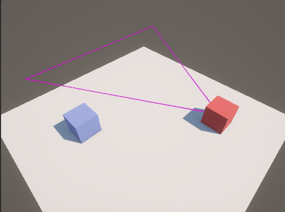
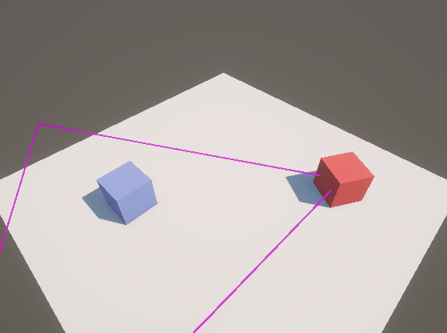

# [게임 수학] 벡터 내적(Dot Product)과 시야각(FOV) 판정

## 1. 개요 (Overview)
게임 개발에서 벡터의 내적(Dot Product, 스칼라곱)은 몬스터 AI의 시야각(FOV, Field of View) 판정, 캐릭터의 전방/후방(백스탭) 판정, 조명 계산(Lambertian Lighting) 등에 가장 빈번하게 사용되는 핵심 수학 연산이다.

---

## 2. 수학적 원리 (Mathematical Background)

### 공식
$$\vec{A} \cdot \vec{B} = |\vec{A}| |\vec{B}| \cos(\theta) = A_x B_x + A_y B_y + A_z B_z$$

두 벡터를 정규화(Normalize, 크기를 1로)하면 공식이 매우 단순해진다:
$$\hat{A} \cdot \hat{B} = \cos(\theta)$$

### 부호에 따른 위치 판정 (전후방 판정)
| 내적 값 ($\cos \theta$) | 각도 ($\theta$) | 기하학적 의미 & 판정 | 게임 내 활용 |
|:---:|:---:|---|---|
| **$1$** | $0^\circ$ | 두 벡터가 **완벽히 같은 방향** | 정면 주시 |
| **$> 0$ (양수)** | $0^\circ < \theta < 90^\circ$ | 두 벡터가 **예각**을 이룸 | **몬스터의 전방(앞쪽)**에 대상 위치 |
| **$0$** | $90^\circ$ | 두 벡터가 **직각 (수직)** | 측면 위치 |
| **$< 0$ (음수)** | $90^\circ < \theta < 180^\circ$ | 두 벡터가 **둔각**을 이룸 | **몬스터의 후방(뒤쪽)**에 대상 위치 (암살/백스탭) |
| **$-1$** | $180^\circ$ | 두 벡터가 **완벽히 정반대 방향** | 완전한 배후 |

---

## 3. 유니티 C# 실무 구현 & 시각화 (Unity Implementation)

### 왜 내적을 쓸까? (성능 최적화)
- 각도를 직접 구하려면 무거운 삼각함수의 역함수(`Acos`)를 호출해야 하므로 CPU 연산 낭비가 심하다.
- 반면 내적은 **단순 곱셈 3번 + 덧셈 2번**으로 끝나며, 미리 구해둔 $\cos(\text{시야각})$ 상수와 비교하기만 하면 초고속으로 판정할 수 있다.

### 시야각 시각화 컴포넌트 (`FOVLine.cs`)
LineRenderer를 활용하여 몬스터의 좌우 시야각 범위를 게임 화면에 직접 라인으로 렌더링한다.
```csharp
using UnityEngine;

public class FOVLine : MonoBehaviour
{
    [SerializeField] private float viewDistance = 10f; // 시야 거리
    [SerializeField] private float viewAngle = 60f;    // 시야각 (전체)
    public float ViewAngle { get { return viewAngle; } } // 외부 접근용 프로퍼티

    private LineRenderer lineRenderer;

    void Start()
    {
        lineRenderer = GetComponent<LineRenderer>(); // LineRenderer 컴포넌트 가져오기
        lineRenderer.positionCount = 4;              // 라인 렌더러의 점 개수 설정
        lineRenderer.startWidth = 0.05f;             // 라인 시작 너비
        lineRenderer.endWidth = 0.05f;               // 라인 끝 너비
    }

    void Update()
    {
        // Y축 회전 쿼터니언을 통해 좌/우 경계 시야 방향 벡터 계산
        Vector3 leftDir = Quaternion.Euler(0, -viewAngle / 2, 0) * transform.forward;
        Vector3 rightDir = Quaternion.Euler(0, viewAngle / 2, 0) * transform.forward;
        
        Vector3 origin = transform.position; // 시야 시작점 (몬스터 위치)
        lineRenderer.SetPosition(0, origin);                           // 시야의 시작점(오브젝트 위치)
        lineRenderer.SetPosition(1, origin + leftDir * viewDistance);  // 왼쪽 시야 끝점
        lineRenderer.SetPosition(2, origin + rightDir * viewDistance); // 오른쪽 시야 끝점
        lineRenderer.SetPosition(3, origin);                           // 삼각형 닫기
    }
}
```

### 시야각 판정 및 회전 컨트롤러 (`EnemyController.cs`)
Space 키 입력 시마다 회전하며 플레이어가 시야각 내에 들어왔는지 내적(`Vector3.Dot`)으로 실시간 검증한다.
```csharp
using UnityEngine;

public class EnemyController : MonoBehaviour
{
    [SerializeField] private Transform player;
    private FOVLine fovLine;

    private void Awake()
    {
        fovLine = GetComponent<FOVLine>();
    }

    void Update()
    {
        if (Input.GetKeyDown(KeyCode.Space))
        {
            // 1. 키 누를 때마다 시야각의 절반(30도)만큼 회전 테스트
            transform.Rotate(0, fovLine.ViewAngle / 2, 0);

            // 2. 몬스터 앞방향 벡터와 플레이어를 향하는 방향 벡터(정규화)
            Vector3 forward = transform.forward;
            Vector3 direction = (player.position - transform.position).normalized;

            // 3. 두 벡터의 내적 (cos theta)
            float dot = Vector3.Dot(forward, direction);

            // 4. cos(시야각 / 2) 기준값과 비교
            if (dot > Mathf.Cos(fovLine.ViewAngle / 2 * Mathf.Deg2Rad))
            {
                Debug.Log("Player is in front of the enemy (시야 내 발견!)");
            }
            else
            {
                Debug.Log("Player is not in front of the enemy (시야 밖)");
            }
        }
    }
}
```

---

## 4. 핵심 요약 (Takeaway)
- 내적 결과의 부호: **양수면 앞($\theta < 90^\circ$), 음수면 뒤($\theta > 90^\circ$)**.
- 각도를 직접 구하지 않고 **`Vector3.Dot`과 `Mathf.Cos(viewAngle / 2 * Mathf.Deg2Rad)`를 직접 비교**하여 CPU 최적화 달성.
- `Quaternion.Euler * forward`를 활용하면 시야 경계 방향 벡터를 손쉽게 시각화할 수 있음.

## 5. 스크린샷



## 6. 플레이 영상 링크
https://youtu.be/1wFPYbWdUfs
