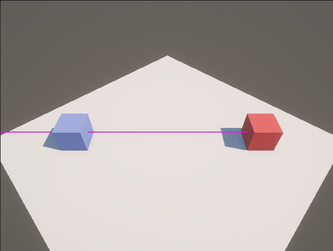

# [게임 수학] 벡터 외적(Cross Product)과 좌우 회전 방향 판정

## 1. 개요 (Overview)
게임 개발에서 벡터의 외적(Cross Product, 벡터곱)은 몬스터 AI가 대상을 향해 좌회전/우회전할지 결정하거나, 폴리곤의 법선 벡터(Normal Vector)를 구해 조명과 표면 방향을 계산할 때 사용되는 핵심 연산이다.

내적이 두 벡터의 사이각을 통해 전방/후방을 판정한다면, 외적은 대상이 내 기준 좌측에 있는지 우측에 있는지를 판정하는 데 사용된다.

---

## 2. 수학적 원리 (Mathematical Background)

### 공식
$$\vec{A} \times \vec{B} = \begin{pmatrix} A_y B_z - A_z B_y \\ A_z B_x - A_x B_z \\ A_x B_y - A_y B_x \end{pmatrix}$$

외적의 결과는 스칼라(단일 실수)가 아니라, **두 벡터 모두에 수직인 새로운 3D 벡터**가 된다.
결과 벡터의 크기는 두 벡터가 이루는 평행사변형의 넓이와 같다:
$$|\vec{A} \times \vec{B}| = |\vec{A}| |\vec{B}| \sin(\theta)$$

### 좌표계와 회전 방향 판정 (좌우 판정)
유니티는 왼손 좌표계(Left-Handed System, X: 우, Y: 상, Z: 전)를 사용한다.
바닥 평면($XZ$)에서 적의 전방 벡터($\vec{F}$)와 플레이어로 향하는 벡터($\vec{P}$)를 외적했을 때, 결과 벡터의 $Y$ 성분 부호로 대상의 위치를 판정한다.

$$\vec{C} = \vec{F} \times \vec{P}$$

| 외적 $Y$ 성분 ($C_y$) | 기하학적 의미 | 판정 결과 | 필요한 회전 |
|:---:|---|---|---|
| **$> 0$ (양수)** | 결과 벡터가 위쪽($+Y$)을 향함 | 대상이 몬스터의 **오른쪽**에 위치 | 우회전 (시계 방향) |
| **$< 0$ (음수)** | 결과 벡터가 아래쪽($-Y$)을 향함 | 대상이 몬스터의 **왼쪽**에 위치 | 좌회전 (반시계 방향) |
| **$= 0$** | 두 벡터가 평행함 ($\sin \theta = 0$) | 대상이 **완벽한 정면 혹은 후방 일직선** | 회전 불필요 또는 180도 반전 |

---

## 3. 유니티 C# 실무 구현 (Unity Implementation)

### 1) 좌우 판정 컨트롤러 (`EnemyController.cs`)
Space 키를 입력받아 적을 30도씩 회전시키며 플레이어의 상대적 위치(좌/우)를 외적으로 판정하는 스크립트.

```csharp
using UnityEngine;

public class EnemyController : MonoBehaviour
{
    [SerializeField] private Transform player;

    void Update()
    {
        if (Input.GetKeyDown(KeyCode.Space))
        {
            transform.Rotate(0, 30, 0); // 키 누를 때마다 30도만큼 회전
            Vector3 forward = transform.forward; // 현재 오브젝트의 전방 벡터
            Vector3 directionToPlayer = (player.position - transform.position).normalized; // 플레이어 방향 벡터 계산

            Vector3 crossProduct = Vector3.Cross(forward, directionToPlayer); // 전방 벡터와 플레이어 방향 벡터의 외적 계산

            // 외적의 y 값에 따라 플레이어가 적의 오른쪽인지 왼쪽인지 판단
            if (crossProduct.y > 0)
            {
                Debug.Log("Player is to the right of the enemy.");
            }
            else if (crossProduct.y < 0)
            {
                Debug.Log("Player is to the left of the enemy.");
            }
        }
    }
}
```

### 2) 전방 시야 시각화 (`FOVLine.cs`)
`LineRenderer`를 이용해 오브젝트의 현재 전방 벡터를 화면에 선으로 렌더링하여 회전 상태를 시각적으로 확인하는 스크립트.

```csharp
using UnityEngine;

public class FOVLine : MonoBehaviour
{
    [SerializeField] private float viewDistance = 10f; // 시야 거리
    private LineRenderer lineRenderer; // LineRenderer 컴포넌트

    void Start()
    {
        lineRenderer = GetComponent<LineRenderer>(); // LineRenderer 컴포넌트 가져오기
        lineRenderer.positionCount = 2; // 라인 렌더러의 점 개수 설정
        lineRenderer.startWidth = 0.05f; // 라인 시작 너비 
        lineRenderer.endWidth = 0.05f; // 라인 끝 너비
    }

    void Update()
    {
        Vector3 origin = transform.position; // 시야의 시작점(오브젝트 위치)
        lineRenderer.SetPosition(0, origin); // 시작점 설정
        lineRenderer.SetPosition(1, origin + transform.forward * viewDistance); // 시야 끝점 설정
    }
}
```

---

## 4. 내적과 외적의 결합 요약

| 연산 | 주요 판정 축 | 판정 대상 | 주 용도 |
|:---:|:---:|:---:|:---|
| **내적 (Dot Product)** | 앞 / 뒤 ($Z$ 축 기준 각도) | 대상이 전방 시야각 내에 있는가? | 시야각(FOV) 감지, 백스탭 공격 판정 |
| **외적 (Cross Product)** | 좌 / 우 ($Y$ 축 기준 회전축) | 대상을 조준하려면 어느 쪽으로 회전해야 하는가? | AI 조준 회전, 궤도 유도, 법선 벡터 생성 |

## 5. 스크린샷

## 6. 플레이 영상 링크
https://youtu.be/HoPkwevN-5A