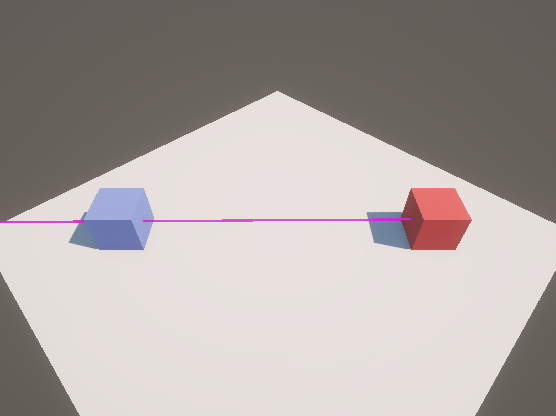
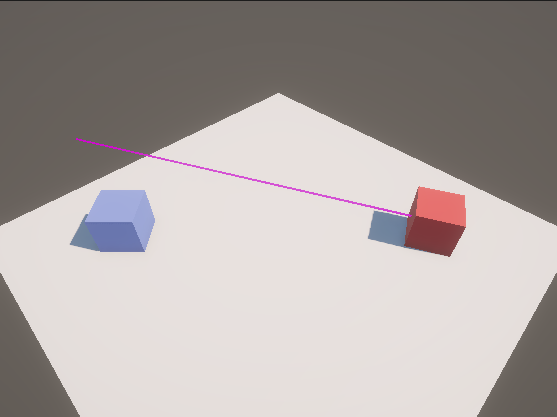

# [게임 수학] 벡터 내적과 외적의 결합: 타겟 추적 회전 (Smooth LookAt)

## 1. 개요 (Overview)
게임 내 몬스터나 터렛 AI가 타겟(플레이어)을 감지하고 자연스럽게 바라보도록 회전시키는 알고리즘이다.
단순히 대상을 즉시 바라보게 하는 `transform.LookAt` 대신, 벡터의 내적(Dot Product)과 외적(Cross Product)을 결합하여 매 프레임 정해진 각속도로 부드럽게 대상을 향해 회전하는 메커니즘을 구현한다.

---

## 2. 수학적 및 물리적 메커니즘

1. **내적을 이용한 도달(정면 정렬) 판정**:
   - $\vec{F} \cdot \vec{P} = \cos(\theta)$
   - 두 벡터가 모두 정규화되어 있을 때, 내적 값이 $1$에 수렴하면 대상이 완벽히 정면에 위치함을 의미한다.
   - 부동소수점 오차 및 각도 오버슈트(Overshoot)로 인한 좌우 떨림(Jittering)을 방지하기 위해 임계값(`0.9999f`)을 두어 회전을 멈춘다.

2. **외적을 이용한 회전 축/방향 판정**:
   - $\vec{C} = \vec{F} \times \vec{P}$
   - 유니티 왼손 좌표계($XZ$ 바닥 평면, $Y$-up) 기준:
     - $C_y > 0$: 대상이 우측에 위치 -> 우회전 (시계 방향, $+Y$축 기준)
     - $C_y < 0$: 대상이 좌측에 위치 -> 좌회전 (반시계 방향, $-Y$축 기준)
   - `Mathf.Sign(crossProduct.y)`를 사용하여 부호를 $+1$ 또는 $-1$로 단순화하여 회전 방향에 곱해준다.

3. **시간 기반 점진적 회전**:
   - `transform.Rotate(0f, turnDirection * turnSpeed * Time.deltaTime, 0f)`
   - 프레임 레이트에 독립적인 일정한 각속도(`deg/sec`) 회전을 보장한다.

---

## 3. 유니티 C# 실무 구현 (`EnemyController.cs`)

```csharp
using UnityEngine;

public class EnemyController : MonoBehaviour
{
    [SerializeField] private Transform player;
    [SerializeField] private float turnSpeed = 90f; // 회전 속도 (도 단위)

    void Update()
    {
        if (Input.GetKeyDown(KeyCode.Space))
        {
            transform.rotation = Quaternion.Euler(0f, Random.Range(0f, 360f), 0f); // 랜덤 회전
        }

        Vector3 forward = transform.forward; // 현재 오브젝트의 전방 벡터
        Vector3 directionToPlayer = (player.position - transform.position).normalized; // 플레이어 방향 벡터 계산

        // 1. 내적으로 정면 여부 판정 (1에 가까울수록 정면)
        float dot = Vector3.Dot(forward, directionToPlayer); // 전방 벡터와 플레이어 방향 벡터의 내적 계산
        if (dot >= 0.9999f) return; // 정면에 위치한 경우, 더 이상 계산하지 않고 종료

        // 2. 외적으로 좌우 여부 판정 (양수면 오른쪽, 음수면 왼쪽)
        Vector3 crossProduct = Vector3.Cross(forward, directionToPlayer); // 전방 벡터와 플레이어 방향 벡터의 외적 계산
        float turnDirection = Mathf.Sign(crossProduct.y); // 외적 벡터의 y값을 통해 회전 방향 결정

        // 3. 점진적으로 회전 적용
        transform.Rotate(0f, turnDirection * turnSpeed * Time.deltaTime, 0f);
    }
}
```

---

## 4. 핵심 정리

| 단계 | 사용 수학/API | 수행 역할 |
|:---:|:---:|:---|
| **방향 벡터 산출** | `(target - origin).normalized` | 대상 방향의 단위 벡터 획득 |
| **정면 정렬 검사** | `Vector3.Dot(forward, dir)` | 목표 각도 도달 여부 및 떨림(Jittering) 방지 데드존 설정 |
| **회전 방향 추출** | `Mathf.Sign(Vector3.Cross(forward, dir).y)` | 시계 방향(+1) 또는 반시계 방향(-1) 결정 |
| **회전 적용** | `transform.Rotate` with `Time.deltaTime` | 프레임 독립적인 점진적 회전 |

## 5. 스크린샷



## 6. 플레이 영상 링크
https://youtu.be/Cb_B3tayB-g